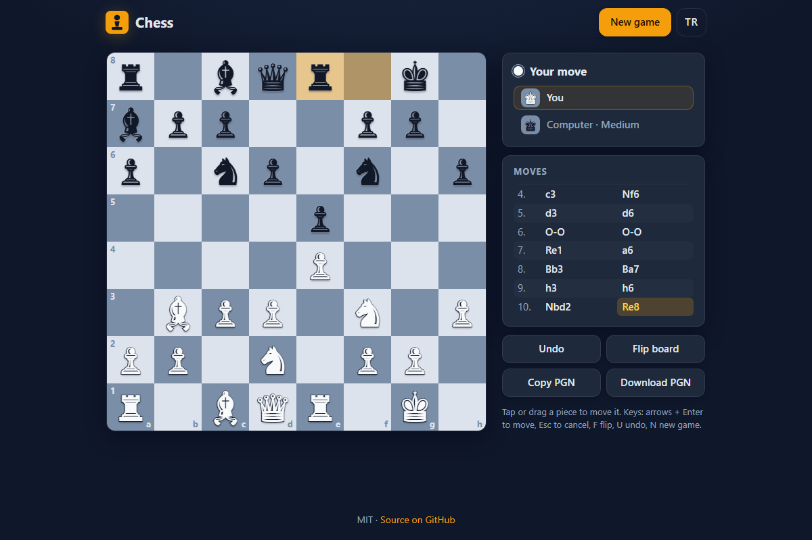

# Chess - full-rules chess in the browser, against a friend or a three-level computer

[](https://github.com/celaldrg/chess-web/actions/workflows/test.yml)
[](LICENSE)

**▶ Play now: https://celaldrg.github.io/chess-web/**



## Features

- Complete rules: castling (never out of, through or into check), en passant, promotion to queen, rook, bishop or knight.
- Checkmate, stalemate and automatic draws by threefold repetition, the fifty-move rule and insufficient material.
- Two players on one device, or play White or Black against the computer: Easy, Medium or Hard.
- The computer is an alpha-beta search (move ordering, quiescence search, piece-square tables) running in a Web Worker, so the page never freezes.
- Click-to-move and drag-and-drop, legal-move dots, last-move and check highlights, a promotion picker.
- Move list in standard algebraic notation (SAN), Undo (the full move pair against the computer), Flip board.
- Copy or download the game as PGN.
- English and Turkish interface, dark theme, works on phones. No build step, no dependencies, nothing loaded from other sites.

## How to play

| | Touch / mouse | Keyboard |
|---|---|---|
| Move a piece | Tap the piece, then a dot, or drag it | Arrow keys to a piece, Enter, arrow keys to the target, Enter |
| Cancel a selection | Tap the piece again | Esc |
| Flip the board | **Flip board** | F |
| Undo | **Undo** | U |
| New game | **New game** (choose mode, colour and level) | N |

Click the board once to give it keyboard focus. **TR / EN** in the header switches the language.

## Run locally

ES modules need `http://`, not `file://`, so use any static server:

```sh
npx serve .
# or: python3 -m http.server 8000
```

Then open the address it prints. Add `?demo` to the URL to see the fixed mid-game position used for the screenshot.

## Tests

```sh
node --test
```

Node 22 or newer, no install needed. The suite covers:

- perft node counts: start position depth 1-4 (20 / 400 / 8902 / 197281), Kiwipete depth 1-3, an endgame position depth 1-4, plus promotion positions;
- rules: checkmate (fool's mate), stalemate, threefold repetition, fifty-move rule, insufficient material, castling legality, en passant, promotion, FEN round-trip, make/undo;
- SAN (disambiguation, `+`, `#`, `=Q`, `O-O`) and PGN export;
- the computer: finds a mate in 1 at every level, wins a hanging queen, respects its time limit;
- UI logic: settings, undo of a move pair, status texts, translations, board geometry and the storage helper.

## Project structure

```
index.html          page, dialogs, Open Graph tags
style.css           dark theme, board, layout
src/position.js     0x88 board, FEN, legal moves, make/undo, perft
src/san.js          SAN generation and parsing
src/pgn.js          PGN export
src/game.js         game controller: history, draws, status, demo game
src/eval.js         evaluation, piece-square tables
src/ai.js           negamax alpha-beta, quiescence, levels
src/ai-worker.js    Web Worker wrapper around the AI
src/rng.js          seeded random numbers
src/session.js      settings, undo pairs, status text (pure)
src/i18n.js         English and Turkish strings
src/storage.js      safe localStorage helper
src/board-view.js   board rendering, pointer and keyboard input
src/ai-client.js    talks to the worker
src/share.js        clipboard and download
src/main.js         wires everything together
test/               node:test suites
```

## License

[MIT](LICENSE) © 2026 Celalettin Durgaç

---

## Türkçe

Tarayıcıda tam kurallı satranç: bir arkadaşına ya da üç seviyeli bilgisayara karşı.

**▶ Hemen oyna: https://celaldrg.github.io/chess-web/**

### Özellikler

- Tüm kurallar: rok (şahtan, şah çekilen kareden geçerek ya da şaha girerek yapılamaz), geçerken alma, vezir, kale, fil ya da ata terfi.
- Şah mat, pat ve kendiliğinden beraberlik: üç kez tekrar, elli hamle kuralı, yetersiz taş.
- Aynı cihazda iki oyuncu ya da bilgisayara karşı Beyaz veya Siyah: Kolay, Orta, Zor.
- Bilgisayar, Web Worker içinde çalışan bir alfa-beta aramasıdır (hamle sıralama, sükûnet araması, taş-kare tabloları); sayfa hiç donmaz.
- Tıklayarak ya da sürükleyerek oynama, yasal hamle noktaları, son hamle ve şah vurguları, terfi seçici.
- Standart cebirsel gösterimde (SAN) hamle listesi, Geri al (bilgisayara karşı iki hamle birden), Tahtayı çevir.
- Oyunu PGN olarak kopyalama ya da indirme.
- İngilizce ve Türkçe arayüz, koyu tema, telefonda çalışır. Derleme yok, bağımlılık yok, başka siteden bir şey yüklenmez.

### Nasıl oynanır

| | Dokunma / fare | Klavye |
|---|---|---|
| Taş oynatma | Taşa, sonra bir noktaya dokun ya da sürükle | Oklarla taşa git, Enter, oklarla hedefe git, Enter |
| Seçimi bırakma | Taşa yeniden dokun | Esc |
| Tahtayı çevirme | **Tahtayı çevir** | F |
| Geri alma | **Geri al** | U |
| Yeni oyun | **Yeni oyun** (mod, renk ve seviye seç) | N |

Klavyeyle oynamak için önce tahtaya bir kez tıkla. Başlıktaki **TR / EN** dili değiştirir.

### Yerelde çalıştırma

ES modülleri `file://` ile değil `http://` ile çalışır; herhangi bir statik sunucu yeterli:

```sh
npx serve .
# ya da: python3 -m http.server 8000
```

Sonra yazdığı adresi aç. Ekran görüntüsündeki sabit oyun ortası konumu için adrese `?demo` ekle.

### Testler

```sh
node --test
```

Node 22 ya da üstü yeter, kurulum gerekmez. Kapsam: perft sayıları (başlangıç konumu 1-4. derinlik: 20 / 400 / 8902 / 197281, Kiwipete, oyun sonu konumu), şah mat, pat, üç kez tekrar, elli hamle, yetersiz taş, rok, geçerken alma, terfi, FEN, SAN ve PGN, bilgisayarın 1 hamlede matı bulması ve süre sınırı, arayüz mantığı (ayarlar, iki hamle geri alma, durum metinleri, çeviriler, depolama).

### Lisans

[MIT](LICENSE) © 2026 Celalettin Durgaç
